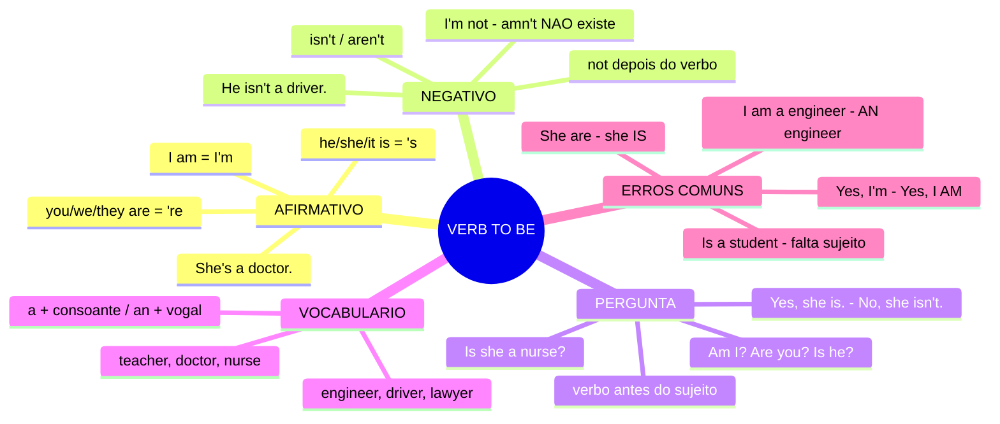

# Piloto: mapa mental na Apostila A1 Adultos (Lição 1 · Verb to be)

**Resumo:** o piloto é viável e barato. O mapa cabe em 1 página, no fechamento da lição, e usa só o conteúdo que já existe na Lição 1 (afirmativo, negativo, interrogativo, vocabulário e erros comuns). Sugiro testar com 1 turma A1 e medir com um quiz de 5 questões antes e depois. Base: artifact "Lição 1 · Verb to be". Não li as páginas Main/Pagina2..5 da apostila (só a lição digital), então o encaixe na paginação é proposta.

## 1. Mapa em Mermaid (cole em qualquer visualizador Mermaid)

## 2. Versão em texto hierárquico (para colar na apostila)

**VERB TO BE** (ser / estar)

1. **AFIRMATIVO** (sujeito + verbo + profissão)
   - I am = **I'm** | you / we / they are = **'re** | he / she / it is = **'s**
   - Modelo: *She's a doctor. They're nurses.*
2. **NEGATIVO** (not depois do verbo)
   - I'm not (amn't não existe) | isn't | aren't
   - Modelo: *He isn't a driver. We aren't lawyers.*
3. **PERGUNTA** (verbo antes do sujeito)
   - Am I...? | Are you / we / they...? | Is he / she / it...?
   - Modelo: *Is she a nurse? Yes, she is. / No, she isn't.*
4. **VOCABULÁRIO**
   - teacher, doctor, nurse, engineer, driver, lawyer
   - a + consoante (a doctor) | an + vogal (an engineer)
5. **ERROS COMUNS**
   - ~~Is a student.~~ → *He is a student.* (o sujeito é obrigatório)
   - ~~She are~~ → *She is*
   - ~~a engineer~~ → *an engineer*
   - ~~Yes, I'm.~~ → *Yes, I am.* (no yes não encurta)

## 3. Onde entra e como medir

| Item | Proposta |
|---|---|
| Posição | Última página da lição, depois dos exercícios, "Resumo visual" (1 página, A4). Espaço em branco no fim para o aluno acrescentar 2 frases suas. |
| Uso em aula | Professor projeta e o aluno completa ramos em branco na primeira revisão; depois cola no caderno. |
| Teste (turma-piloto) | Quiz de 5 questões sobre Verb to be, aplicado antes e 1 semana depois da lição com o mapa. Mesmas questões, ordem trocada. Ex.: "___ she a nurse?", "They ___ lawyers", transformar em negativa, corrigir "I am a engineer". |
| Indicador | Média de acertos depois menos antes, em pontos. Meta: +1 acerto em média (de 5). |
| Comparação | Se possível, outra turma A1 sem o mapa faz o mesmo quiz (grupo de controle simples). Sem controle, o resultado é só indicativo. |
| Opinião | 2 perguntas ao aluno: "Usou o mapa para revisar?" e "Ajudou a lembrar?" (sim/não). |
| Decisão | Se ganho >= +1 e maioria "ajudou": estender às demais lições do A1 e testar em Informática. Se não: manter só como página de revisão opcional. |

Custo: baixo (1 página por lição, sem custo de impressão relevante). Tempo para o Júnior: cerca de 30 min para diagramar no formato da apostila. Combina com o Kit do Aluno (#22).

## Alertas
- Quiz e turma-piloto ainda não definidos; sem número de alunos não dá para afirmar resultado (hipótese, não fato).
- Mermaid pode não renderizar na apostila impressa: usar a versão em texto ou desenhar o mapa no editor visual.
- Resultados da turma-piloto devem ser registrados de forma agregada (média da turma), sem nomes de alunos (LGPD).

## Próximas ações
1. Júnior: escolher 1 turma A1 e a data da Lição 1 (até 01/12).
2. Pelennor: preparar o quiz de 5 questões e o gabarito (até 28/11, após o OK do Júnior).
3. Isengard e o professor da turma: aplicar antes/depois e devolver a média ao Pelennor (até 15/12); Pelennor consolida o resultado.

— Pelennor, Coordenador Pedagógico
